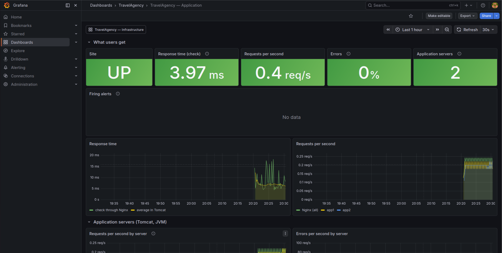
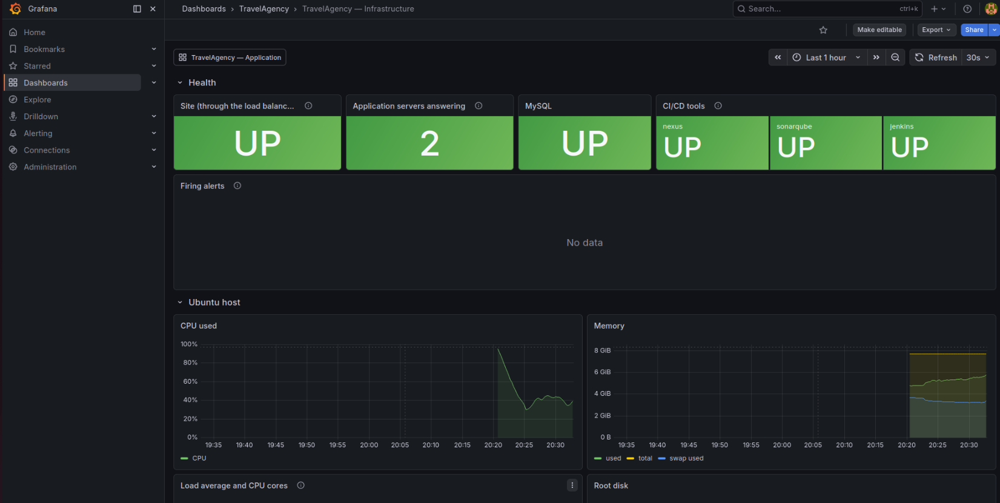
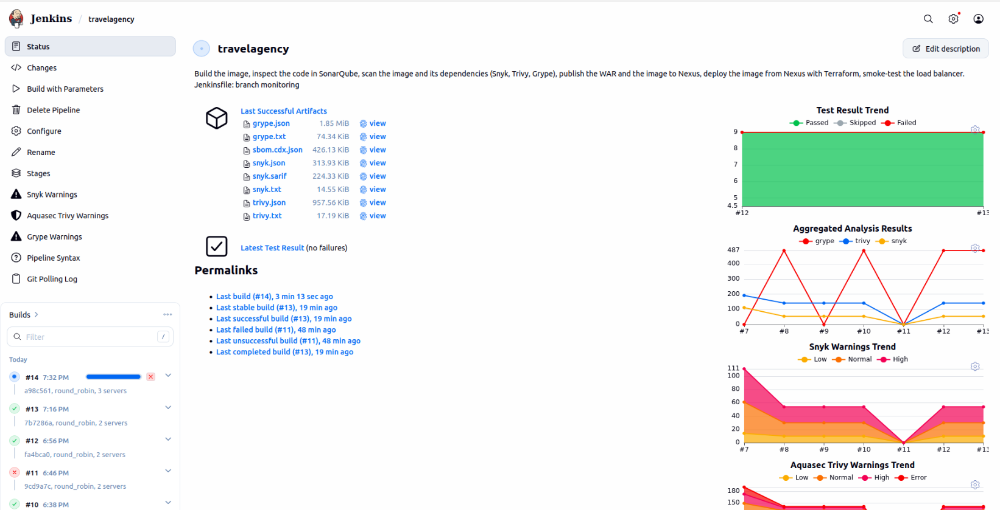

# DevOps Report

## General Information

**Period:** 16.10.2026 – 22.10.2026
**Report date:** 22.10.2026
**Author:** Rostyslav
**Project:** TravelAgency

**Goal:** Keep every build of TravelAgency in an artifact repository, check the dependencies, the image and the code on every build, and watch the application and the server with monitoring that also shows how much load the setup can take.

**Summary:** This week covered four cards, each in its own branch on top of the `jenkins` branch. Jenkins now stores the WAR and the image of every commit in Nexus and deploys the image from there. Every build scans the dependencies with Snyk and the image with Trivy and Grype, and a security gate stops a build with a fixable critical vulnerability. In the original libraries Trivy found 18 critical vulnerabilities, Spring4Shell among them; after the upgrade four are left, and none of them has an open-source fix in Spring 5. SonarQube checks the code and the first unit tests on every build. Prometheus and Grafana watch the host, the containers, Tomcat, MySQL, Nginx and the CI tools; an alert was triggered for real, and the load test went up to almost 400 requests per second without reaching the limit of the application. Everything was run on the Ubuntu VM in VMware Workstation (192.168.58.128).

## Goals

**Main goal:** Complete the four cards:

- "Artifact Management"
- "Scanning images and dependencies in CI/CD (Trivy/Grype + Snyk SCA)"
- "Implement CCI (Continuous Code Inspection)"
- "Monitor resource usage and plan for scalability" and "Set up monitoring tools for application performance and infrastructure health"

**Other goals:**

- Keep one branch per approach: `jenkins` → `artifact-management` → `security-scanning` → `code-inspection` → `monitoring`.
- Configure every tool from code (Docker Compose files and setup scripts), with passwords only in `.env` files and Jenkins credentials.
- Check every result on the real machine.
- Keep the whole repository in English.

## Tasks Completed

| # | Task | Status | Owner | Finished | Notes |
| --- | --- | --- | --- | --- | --- |
| 1 | Nexus Repository CE 3.96.4 in Docker (branch `artifact-management`): Maven repository `travelagency-maven` and Docker registry `travelagency-docker`, both "allow once", so a published version cannot be overwritten. Anonymous access off; Jenkins has its own user with a role limited to these two repositories (read, upload, delete old versions). `nexus/setup.py` configures it all through the REST API and can run again | Done | Rostyslav | 22.10.2026 | UI on port 8091, registry only on `127.0.0.1:8092` |
| 2 | Pipeline stages Publish to Nexus (WAR `org.project:TravelAgency:1.0-<commit>`, image `travelagency:<commit>`), Pull from Nexus (the servers run the image pulled from Nexus), Nexus retention (5 newest versions plus the deployed one). Parameter `ROLLBACK_TO` deploys an older version from Nexus without building | Done | Rostyslav | 22.10.2026 | Build #6 |
| 3 | Scans in the pipeline (branch `security-scanning`): Snyk CLI for the Maven dependencies, Trivy and Grype for the image. Reports are archived with the build and shown in Jenkins (Warnings NG); `snyk monitor` keeps a snapshot in the Snyk web UI | Done | Rostyslav | 22.10.2026 | Tools pinned in the Jenkins image, checked against SHA-256 |
| 4 | Security gate: stops the build on a CRITICAL vulnerability that has a fixed version, in any of the three scanners. Exceptions only through `ci/accepted-risks.txt`: ID, end date, reason | Done | Rostyslav | 22.10.2026 | After the end date the risk blocks again |
| 5 | SBOM: Trivy writes a CycloneDX list of every package in the image; it is stored in Nexus next to the WAR | Done | Rostyslav | 22.10.2026 | 231 components |
| 6 | Library upgrade: Spring Framework 5.3.9 → 5.3.39, Spring Security 5.6.0 → 5.8.16, MySQL Connector/J 8.0.23 → 8.4.0, Hibernate 5.6.10 → 5.6.15, Logback 1.2.3 → 1.2.13; unused Thymeleaf and Jetty and duplicate declarations removed from `pom.xml` | Done | Rostyslav | 22.10.2026 | Results below |
| 7 | SonarQube Community Build 26.9 with PostgreSQL 17 in Docker (branch `code-inspection`). `sonarqube/setup.py` sets the admin password, requires login, creates a private project and a token that can only analyse it | Done | Rostyslav | 22.10.2026 | |
| 8 | First unit tests: 9 tests with JUnit 5 and Mockito for `CountryServiceImpl`, `BookingServiceImpl`, `StringToLocalDateConverter`; coverage with JaCoCo. New stage Code inspection: tests, coverage and analysis, then the build waits for the quality gate | Done | Rostyslav | 22.10.2026 | Quality gate "Sonar way" |
| 9 | Monitoring (branch `monitoring`): Prometheus 3.15, Grafana 12.4, node-exporter, cAdvisor, mysqld-exporter, nginx-exporter, blackbox-exporter. Tomcat metrics from the JMX exporter, added to the image as a Java agent | Done | Rostyslav | 22.10.2026 | 13 targets |
| 10 | Prometheus finds the application servers through the Docker DNS name `app`, so scaling needs no change in the monitoring | Done | Rostyslav | 22.10.2026 | |
| 11 | 15 alert rules (site, servers, MySQL, CI tools, errors, response time, heap, threads, host CPU, memory, disk) with unit tests (`promtool test rules`); recording rules for capacity numbers | Done | Rostyslav | 22.10.2026 | |
| 12 | Two Grafana dashboards from files in Git: Infrastructure and Application | Done | Rostyslav | 22.10.2026 | Screenshots below |
| 13 | Load test script `monitoring/loadtest.py` (k6): runs several loads, reads what the servers used from Prometheus, writes a table and a capacity estimate | Done | Rostyslav | 22.10.2026 | |
| 14 | Translated the last Ukrainian text of the application (a button, the 403 message, two screenshots) to English in all 11 branches | Done | Rostyslav | 22.10.2026 | |
| 15 | README for each new branch, branch list in `main`, new branches in `scripts/check-project.sh` | Done | Rostyslav | 22.10.2026 | |

## Results

**What I did:**

- Put Nexus between the build and the deployment: the servers run the image from Nexus, and every version stays there.
- Added three scanners and one gate to the pipeline, and fixed what they found.
- Added SonarQube and the first unit tests to every build.
- Set up monitoring of the application, the host and the CI tools, triggered an alert for real and measured the load.

**What I achieved:**

**1. Artifact management.** Build #6 published the WAR (`TravelAgency-1.0-bfb250d.war`) and the image (`localhost:8092/travelagency:bfb250d`, 12 layers) to Nexus, pulled the image back from Nexus, deployed it with Terraform and passed the smoke test (5 / 5 / 5 requests). Every later successful build published its own version the same way.

**2. Scanning.** The first build with the scans used the original libraries. The upgrade changed the numbers as follows:

| | Original libraries (build #7) | After the upgrade (build #8) |
| --- | --- | --- |
| Snyk: dependencies / issues | 54 / 111 | 44 / 54 |
| Trivy: HIGH and CRITICAL in the jars of the image | 42 (18 critical) | 11 (3 critical) |
| Packages in the image (SBOM) | 242 | 231 |
| Security gate | Not reached (Problem 1) | Passed: 0 blocking, 4 accepted |

Among the critical vulnerabilities of the original libraries were Spring4Shell (CVE-2022-22965, remote code execution in exactly this setup: Spring MVC in a WAR on Tomcat with JDK 9+), an authorization bypass in Spring Security (CVE-2022-22978) and template injection in Thymeleaf, which the application did not even use.

Four critical vulnerabilities have no open-source fix in Spring 5: the fixes are in Spring 6/7 (Jakarta EE, Tomcat 10), and the 5.x fixes are sold only as Enterprise Support. I checked each one against the code and accepted it until 30.04.2027:

| ID | Library | What it is | Why it is accepted for now |
| --- | --- | --- | --- |
| CVE-2016-1000027 | spring-web | Java deserialization in `HttpInvokerServiceExporter` | The application does not use HTTP Invoker or Java deserialization |
| CVE-2026-47884 | spring-webmvc | SSRF and remote code execution through `XsltView` with a `"/**"` mapping | Views are JSP only; no `XsltView`, no `"/**"` view mapping |
| CVE-2026-22732 | spring-security-web | Security headers are not written when the application sets such headers itself | The application neither configures nor sets response headers |
| CVE-2025-22228 | spring-security-crypto | BCrypt compares only the first 72 bytes of a password | A real but small risk: only for passwords longer than 72 bytes |

**3. Code inspection.** Build #12: `Tests run: 9, Failures: 0`, coverage sent to SonarQube, 120 files in 5 languages analysed (Java, JSP, HTML, CSS, XML), `QUALITY GATE STATUS: PASSED`. Jenkins shows the test trend on the job page. The whole pipeline (build, inspection, three scans, publish, deploy, smoke test) takes about 3 minutes (builds #12–#19: 2.6–3.6 min).

**4. Monitoring.** All 13 targets of Prometheus are up: the host, the containers, MySQL, Nginx, both Tomcats (from inside through JMX and from outside through the load balancer and directly), Jenkins, Nexus and SonarQube.

An alert for real: `app2` was stopped, the site was checked every 15 seconds.

| Time | Event | Site | AppServerGone (app2) |
| --- | --- | --- | --- |
| 20:39:59 | `docker stop travelagency-tf-app2` | HTTP 200 | — |
| 20:40:46 | Prometheus no longer finds `app2` | HTTP 200 | pending |
| 20:42:46 | 2 minutes later, as the rule says | HTTP 200 | firing |
| 20:42:47 | `docker start travelagency-tf-app2` | HTTP 200 | firing |
| 20:43:17 | `app2` is found again | HTTP 200 | resolved |

The site answered at every check: Nginx sent all users to the other servers.

**5. Load test and capacity.** k6 opened the login page with 10, 25 and 50 virtual users, 2 minutes each; every user sends one request per second. Service level: 95 % of the requests under 1 s and less than 1 % errors.

| Servers | Requests per second (10 / 25 / 50 users) | p95 | Errors | CPU of all servers (max) | Memory of one server (max) | Host memory used |
| --- | --- | --- | --- | --- | --- | --- |
| 3 | 9.9 / 24.9 / 49.7 | 7–14 ms | 0 % | 0.12 cores | 262 MB | 76–78 % |
| 2 | 9.9 / 24.9 / 49.6 | 8–10 ms | 0 % | 0.07 cores | 247 MB | 64–73 % |
| 1 | 9.9 / 24.9 / 49.7 | 6–11 ms | 0 % | 0.03 cores | 250 MB | 69–72 % |

Then a heavier test with 2 servers, to look for the limit:

| Users | Requests per second | p95 | Average | Errors | CPU of both servers | Host CPU | Memory of one server (max) |
| --- | --- | --- | --- | --- | --- | --- | --- |
| 100 | 98.6 | 19 ms | 9 ms | 0 % | 0.24 cores | 34 % | 290 MB |
| 200 | 198.0 | 9 ms | 4 ms | 0 % | 0.24 cores | 36 % | 299 MB |
| 400 | 394.9 | 12 ms | 6 ms | 0 % | 0.28 cores | 45 % | 283 MB |

Even at almost 400 requests per second the service level was met with a large margin, so the limit was not reached. k6 runs on the same VM and took a large part of the CPU itself (the other processes used 0.62 cores in the 400-user run), so finding the real limit needs k6 on another machine. From the CPU per request, the script estimates about 640 requests per second at 70 % of the host CPU; this is an extrapolation, not a measurement.

What this means for capacity:

- The application is not the limit. Two servers answered almost 400 requests per second of the login page with 0.28 of a CPU core in total, in milliseconds and without errors; with 50 requests per second, even one server was enough.
- The limit is the VM. It has 2 CPU cores and 7.7 GB of memory, shared with Jenkins, Nexus, SonarQube and the monitoring; memory was 64–78 % used. One application server needs 250–300 MB, so there is room for 2–3 more.
- More servers on the same VM do not add CPU; they add availability (the alert test above). More throughput needs more cores or the CI tools on a separate VM.
- The CPU per request that the script calculates (0.7–3.2 ms) is not reliable at low load: most of the measured CPU is the idle work of each Java VM, so more servers look more expensive per request. The heavier the load, the closer the number gets to the real cost.
- The login page does not use the database (2 connections at most). Pages that read the database still need to be measured (Next Steps).

**Builds of the week:**

| Build | Branch, commit | What it built | Servers | Result | Time |
| --- | --- | --- | --- | --- | --- |
| #6 | `artifact-management` `bfb250d` | Publish to Nexus, deploy from Nexus, retention | 3 | `SUCCESS` | 1.1 min |
| #7 | `security-scanning` `d510d8f` | The scans, with the original libraries | 3 | `FAILURE`: Grype, full disk (Problem 1) | 2.8 min |
| #8 | `security-scanning` `54aee3d` | Library upgrade, accepted risks, Grype fix | 3 | `SUCCESS`, security gate passed | 5.2 min (first download of the Grype database) |
| #9 | `security-scanning` `54aee3d` | The same commit | 2 | `FAILURE`: Jenkins restarted during the build (Problem 5) | 11.6 min |
| #10 | `security-scanning` `54aee3d` | The same commit; Jenkins still used this branch (Problem 6) | 2 | `SUCCESS` | 1.7 min |
| #11 | `code-inspection` `9cd9a7c` | An outdated version of the branch (Problem 7) | 2 | `FAILURE`: tests with mocks in the Docker build (Problem 8) | 0.4 min |
| #12 | `code-inspection` `fa4bca0` | SonarQube, unit tests, mocks as subclasses | 2 | `SUCCESS`: 9 tests, quality gate passed | 3.1 min |
| #13 | `monitoring` `7b7286a` | JMX exporter in the image, DNS name `app` for the servers | 2 | `SUCCESS` | 3.2 min |
| #14 | `monitoring` `a98c561` | Fix of `monitoring/setup.py`, started by polling | 3 | `SUCCESS` | 3.3 min |
| #15–#18 | `monitoring` `a98c561` | The load tests: 3, 2 and 1 servers, then back to 2 | 3 → 2 → 1 → 2 | `SUCCESS` | 2.6–3.6 min |
| #19 | `monitoring` `2be8036` | The English text | 2 | `SUCCESS`: quality gate passed | 3.6 min |

14 builds: 11 `SUCCESS`, 3 `FAILURE`. Every failure is a row in Problems and Solutions.

## Problems and Solutions

| # | Problem | Solution | Status |
| --- | --- | --- | --- |
| 1 | Build #7 stopped in the Grype stage with exit code 1 and no message. `--quiet` in Grype hides the errors too. Run by hand, Grype said `no space left on device`: the 34 GB disk of the VM was 93 % full | The database of Grype is downloaded in a separate step and the scan runs without `--quiet`, so the build log shows the reason. Freed 3 GB (Docker build cache, apt cache, old logs), then expanded the virtual disk to 60 GB and grew the partition (`growpart`, `resize2fs`) | Done |
| 2 | `pom.xml` declared `mysql-connector-java` four times with different versions; Maven used the last one, 8.0.23 | One declaration, under the new coordinates `com.mysql:mysql-connector-j` 8.4.0 | Done |
| 3 | Four critical vulnerabilities have no open-source fix in Spring 5 | Accepted with a reason until 30.04.2027 (table above). The real fix is the migration to Spring 6, Jakarta EE and Tomcat 10 | Open |
| 4 | Memory: SonarQube needs about 2 GB, and the VM has 8 GB for Jenkins, Nexus, MySQL and the application servers | Added a second swap file (6 GB of swap in total), deployed with 2 servers; the monitoring shows the memory of every container | Done |
| 5 | The Jenkins container was recreated during build #9 (to load a new configuration). The build lost its running stage and failed after 10 minutes | Restart Jenkins only when no build runs; the helper scripts wait until Jenkins is idle | Done |
| 6 | Build #10 still built the previous branch: `REPO_BRANCH` in `jenkins/.env` was not changed | Changed it; the scripts now check which branch Jenkins uses before they start a build | Done |
| 7 | Build #11 built an outdated version of `code-inspection`: the updated Git bundle with the branch had not been downloaded, and an older bundle with the same file name was used | Bundles get unique file names. The branch on GitHub was replaced with `git push --force-with-lease`, which works only if the branch still points to the expected old commit | Done |
| 8 | In build #11 all seven tests with mocks failed inside the Docker build: `Could not initialize plugin: interface org.mockito.plugins.MockMaker`. The default mock maker of Mockito 5 has to attach an agent to the running JVM, and it could not start there | The tests mock only DAO interfaces, so Mockito now makes mocks as subclasses (`mock-maker-subclass`), which needs no agent. Before the push, the tests were run in the Docker build on the VM | Done |
| 9 | `monitoring/setup.py` waited 3 minutes for Prometheus and gave up, although Prometheus was ready in a second: `/-/ready` answers with plain text, and the script took every answer that is not JSON for no answer | The script checks the HTTP status and parses JSON only where it needs it | Done |
| 10 | Two pages and two screenshots still had Ukrainian text from the original project; the 403 page showed the message of Spring Security in the language of the browser | Translated in all 11 branches; the 403 page always says "Access is denied" | Done |
| 11 | A change of the algorithm or of the number of servers recreates the Nginx container, and the site does not answer for a few seconds | — | Open (from the last report) |

## Next Steps

- Migrate to Spring 6, Jakarta EE and Tomcat 10 before 30.04.2027, so the four accepted vulnerabilities are fixed for real (Problem 3).
- Send alerts by e-mail or messenger with Alertmanager; now they are visible only in Grafana and Prometheus.
- Load test with signed-in users, so the pages that read the database are measured too, and with k6 on another machine, so the load generator does not take the CPU of the VM it measures.
- More unit tests: the quality gate checks the coverage of new code, so it grows with every change.
- More CPU and memory for the VM, or the CI tools (Jenkins, Nexus, SonarQube) on a separate VM.

## Tools and Technologies Used

- **Sonatype Nexus Repository CE 3.96:** Maven repository and Docker registry.
- **Snyk CLI 1.1307, Trivy 0.75, Grype 0.120:** vulnerabilities in the dependencies and in the image; CycloneDX SBOM.
- **SonarQube Community Build 26.9, PostgreSQL 17, SonarScanner for Maven 5.8:** code analysis and quality gate.
- **JUnit 5.14, Mockito 5.24, JaCoCo 0.8.15, Maven Surefire 3.5:** unit tests and coverage.
- **Prometheus 3.15, Grafana 12.4, node-exporter 1.12, cAdvisor 0.60, mysqld-exporter 0.20, nginx-prometheus-exporter 1.5, blackbox-exporter 0.28, Prometheus JMX exporter 1.6:** monitoring and alerts.
- **k6 1.8:** load tests.
- **Jenkins (Warnings NG, JUnit), Terraform, Docker, VMware Workstation, Ubuntu 22.04:** the pipeline and the machine from the previous weeks.

## Comments and Conclusions

The four cards made the pipeline answer three questions before a commit reaches the servers: is this exact version stored, does it contain known vulnerabilities, does the code pass the quality gate. The scans paid off at once: the original project carried Spring4Shell and an authorization bypass, which nobody had noticed because nothing looked for them. They also showed the limit of upgrading inside Spring 5: some fixes exist only in Spring 6, so those risks are now written down with a reason and an end date instead of being ignored. Most problems of the week again appeared only on the real machine: a full disk, memory shared by many services, a tool that hides its own errors. The monitoring made the next problem of this kind visible: the disk alert fires at 85 %, and the dashboards show which container uses the memory.

## Appendix and Resources

- Instructions: README of the branches `artifact-management`, `security-scanning`, `code-inspection`, `monitoring`
- Code: `nexus/`, `ci/nexus.sh`, `ci/scan.sh`, `ci/accepted-risks.txt`, `sonarqube/`, `src/test/`, `monitoring/`, `Jenkinsfile`, `jenkins/`
- Load test results: `monitoring/results/` on the VM
- Nexus REST API: <https://help.sonatype.com/en/rest-and-integration-api.html>
- Snyk CLI: <https://docs.snyk.io/developer-tools/snyk-cli>
- Trivy: <https://trivy.dev/>
- Grype: <https://github.com/anchore/grype>
- SonarQube quality gates: <https://docs.sonarsource.com/sonarqube-community-build/quality-standards-administration/managing-quality-gates/introduction-to-quality-gates/>
- Prometheus alerting rules: <https://prometheus.io/docs/prometheus/latest/configuration/alerting_rules/>
- Prometheus JMX exporter: <https://github.com/prometheus/jmx_exporter>
- k6: <https://grafana.com/docs/k6/latest/>
- Spring security advisories: <https://spring.io/security>
